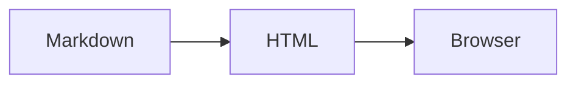

# mdview

A small Markdown-to-HTML compiler written in C. Run it on a Markdown file to
create a styled, temporary HTML page and open it in your default browser.
There are no rendering libraries or language-runtime dependencies.

## Install with Homebrew

```sh
brew install danielhundhausen/tap/mdview
mdview foo.md
```

The formula builds from source. On Linux, `xdg-open` must also be installed
through your system's package manager to open the browser.

## Build from source

```sh
make
./mdview foo.md
```

To explore the supported elements and syntax highlighting, render the repository
showcase with `./mdview example.md`. The example and its local illustration are
excluded from source archives and are not installed with the executable.

To use `mdview` from anywhere, install it into a directory on your `PATH`:

```sh
make install PREFIX="$HOME/.local"
# Add $HOME/.local/bin to PATH if it isn't already there.
mdview foo.md
```

The build needs a C99 compiler and Make. macOS uses `open`; Linux uses
`xdg-open`, which must be installed to launch your browser. The renderer itself
needs neither command when using `--no-open`.

## Usage

```sh
mdview notes.md                      # Render and open in your browser
mdview --no-open notes.md            # Render and print the temporary HTML path
mdview -o notes.html notes.md        # Save to a chosen file and open it
mdview --no-open -o notes.html notes.md
mdview --watch notes.md              # Refresh the open preview as you edit
mdview --watch --no-open notes.md    # Print the live preview URL without opening it
mdview --toc notes.md                # Always include a collapsible outline
mdview --no-toc notes.md             # Hide the outline, even in longer documents
cat notes.md | mdview -              # Read standard input
mdview -- --strange-filename.md      # Filenames beginning with a dash
mdview --help
```

The command prints the absolute HTML path. Temporary files have a `.html`
extension, unique names, and owner-only permissions. They go into `TMPDIR`,
or `/tmp` when it is unset. They remain after the command exits so the browser
can read and reload them; delete them when you no longer need them. Explicit
output files are overwritten, except that overwriting the source is rejected.
Use `--watch` for a live preview, or rerun the command to update a snapshot.

With `--watch`, mdview stays running and prints an HTTP preview URL instead of
the HTML path. It opens that URL once and watches the Markdown contents for
changes, including when an editor replaces the file on save. The page refreshes
automatically and restores its horizontal and vertical scroll position, including
after images and diagrams finish rendering. Browser JavaScript must be enabled.
The server listens only on `127.0.0.1`, on an automatically chosen port. Local
images and links within the Markdown file's directory (and its subdirectories)
are served by the preview server; paths outside that directory are not served.
No external service or additional runtime is required.

Stop watching with **Ctrl+C**. The saved HTML remains available at the path
printed on stderr; `-o FILE` selects that file as usual. It can still be opened
directly after watching ends. `--no-open` starts the same live preview without
launching a browser. Watch mode requires a regular file and rejects standard
input. Failed renders or a temporarily missing source keep the last successful
preview available; valid edits resume updates.

Relative images and links resolve against the source file's directory, even
when the HTML is in a temporary directory. For standard input, they resolve
against the current working directory. The generated page includes its own
CSS with a warm paper layout, serif headings, system fonts, light/dark themes,
accessible link focus indicators, responsive layout, and print styles. Pages
without code blocks, a table of contents, or `--watch` use no JavaScript,
web fonts, or remote stylesheets. Code
blocks, Mermaid diagrams, and mathematics include their browser assets as described below.
Remote images can still be loaded if the document references them.

## Heading links and table of contents

Every ATX and Setext heading has an ID and a small **#** permalink next to its
text. Click the permalink to jump to that section, or copy its link using your
browser. Markdown links such as `[Installation](#installation)` jump within the
preview. Fragment navigation works in saved HTML and live previews while relative
images and file links continue to resolve against the Markdown directory.

IDs come from the visible heading text: formatting and link destinations are
removed, ASCII letters become lowercase, spaces become hyphens, and ASCII
punctuation is removed except for hyphens and underscores. UTF-8 characters are
preserved. For example, `## Installation` becomes `#installation`, and
``## **Using** `mdview` `` becomes `#using-mdview`. Repeated IDs receive `-1`, `-2`,
and so on, avoiding collisions with earlier headings; empty or punctuation-only
headings use `section`. IDs remain the same when unrelated text changes.

Documents with four or more headings automatically include a
**Table of contents** in a separate sidebar to the left of the document. The sidebar
stays visible while scrolling; on narrow screens it sits above the document.
Expand it to see links nested by heading level.
Initially, the outline is expanded on screens wider than 1000 pixels and collapsed
on narrower screens. You can toggle it at any time; resizing keeps your choice.
A soft wash behind the current section's label glides between entries as you
scroll. It follows the label's width and adapts to both themes; reduced-motion
preferences disable the animation.
Use `--toc` to include it in shorter documents, or `--no-toc` to hide it.
Documents without headings never show an empty outline. When both flags are
given, the last one wins. Headings inside lists and blockquotes are included;
heading-like text inside code blocks is ignored.

Heading links and the outline work without JavaScript in saved pages and are
hidden when printing. The viewport defaults and current-section highlight use
a small embedded script; without JavaScript, the outline starts collapsed and
remains manually expandable. Watch mode preserves the outline's expanded state on
automatic refreshes.

## Code blocks

Fenced blocks with a supported language label (for example `js`, `python`, `c`,
`bash`, `json`, `html`, or `sql`) receive syntax highlighting from the embedded
**Highlight.js 11.12.0** common-language build. Language aliases and uppercase
labels are supported. Unlabeled, indented, and unknown-language blocks remain
plain text; language detection is not automatic.

Every fenced or indented code block has a copy icon in its upper-right corner,
including Mermaid's source disclosure. Copying preserves the rendered source text, whitespace,
and trailing newline, without syntax markup or button labels. The existing
Markdown parser normalizes CRLF line endings and expands tabs to four-column
stops. A local-file clipboard fallback is used when the browser's Clipboard API
is unavailable or denies access. Buttons show success or failure, announce the
result to assistive technology, and allow retries. The icon briefly becomes a
checkmark on success; a failed copy shows a hint for copying manually. These
controls sit beside the content without adding a toolbar row.

Code assets are embedded once, only when a document contains block code, and
work offline without a CDN or runtime files. Syntax highlighting and buttons
require JavaScript; escaped source remains readable when it is disabled.
The code palette works with both document themes, and copy controls are hidden
when printing. Code pages add approximately 134 KB of CSS and JavaScript.

## Mermaid diagrams

Use a fenced block labeled `mermaid`:

````markdown

````

Diagrams use the document's colors and system font, adapt when the light/dark
theme changes, and scale down to fit the reading column. Use the expand icon in
the upper-right corner to open a diagram in a full-screen overlay, with zoom
controls, **Fit width**, and a
100% view. Close with the button, Escape, or a click on the backdrop. The original
diagram source is available in a disclosure below each diagram.

The executable contains **Mermaid 12.1.0**, compressed with DEFLATE. A small
vendored C decompressor expands the library into the generated HTML only when
Mermaid fences are present. Diagram pages
include approximately 5.5 MB of JavaScript. Ordinary pages remain small.

Diagram rendering requires browser JavaScript and works offline. No Node.js,
zlib installation, CDN connection, or accompanying runtime files are needed.
Diagram text stays local. If JavaScript is disabled or diagram syntax is invalid,
the escaped source remains readable. External images, links, or explicitly
configured remote icon resources can still use the network.
Mermaid runs in strict mode, which disables diagram click handlers and encodes
HTML labels. See the [Mermaid usage guide](https://mermaid.js.org/config/usage).

## Mathematics

Write TeX inline with `$...$` or `\(...\)`, as a display block with
`$$...$$` or `\[...\]`, or in a fenced block labeled `math`:

````markdown
Einstein's relation $E = mc^2$ and the integral below are rendered.

$$
\int_0^1 x^2 \, dx = \frac{1}{3}
$$

```math
\sum_{i=1}^n i = \frac{n(n+1)}{2}
```
````

Rendered mathematics follows the document's text color in both themes and
scales to fit the reading column; wide display expressions scroll
horizontally. The original TeX for a `math` fence is available, with a copy
button, in a disclosure below the rendered result. Inline and display TeX
also works inside headings, lists, blockquotes, and table cells. Dollar
amounts such as $5 and $10, math inside code spans or code blocks, and
`\$` escapes stay literal.

The executable contains **MathJax 3.2.2** (the TeX-to-SVG build), compressed
with DEFLATE in the same way as Mermaid. The same vendored decompressor
expands the library into the generated HTML only when a document contains
mathematics. Math pages include approximately 2.1 MB of JavaScript; the
binary is approximately 2.4 MB. SVG output inlines its glyphs, so no web
fonts, CDN connection, or accompanying runtime files are needed.

Math rendering requires browser JavaScript and works offline. If JavaScript
is disabled or an expression is invalid, the escaped TeX source remains
readable in place.

## Markdown support

- ATX (`#`) and single-line Setext headings, paragraphs, and horizontal rules
- Heading IDs, section permalinks, and an optional collapsible table of contents
- Bold, italics, combined emphasis, strikethrough, and punctuation escapes
- Inline code, fenced code with optional language labels, and indented code
- Offline syntax highlighting for supported fenced languages and code copy buttons
- Mermaid diagrams in `mermaid` fences, including inside lists and blockquotes
- Inline (`$...$`, `\(...\)`), display (`$$...$$`, `\[...\]`), and fenced (`math`) TeX mathematics
- Bullet and numbered lists, nested lists, and task checkboxes
- Blockquotes, including nested blocks
- Inline links and images, optional quoted titles, and angle-bracket URL/email links
- Pipe tables with left, center, and right column alignment
- Hard line breaks from two trailing spaces or a trailing backslash
- UTF-8 text, optional UTF-8 BOM, and Unix/Windows line endings

This is a pragmatic Markdown subset, not a full CommonMark or GitHub Flavored
Markdown implementation. Reference-style links, footnotes,
bare URL linking, and some complex delimiter/list/
table edge cases are not supported. Raw HTML is displayed as text. URL schemes
are limited to `http`, `https`, `mailto`, and `file`, plus relative paths.
Nesting is bounded to keep malformed documents from exhausting the C stack.

## Tests

```sh
make test
make test-js
```

`make test` requires Python 3 and covers rendering, malformed input, CLI errors,
asset paths, temporary-file permissions, module activation, and browser launching
with a stub command. It also verifies the decompressed library's SHA-256 against
the vendored manifest. It also covers conditional code assets, controls in nested
blocks, safe HTML escaping, and the vendored highlighter's checksums.
`make test-js` requires Node.js and tests the Mermaid adapter with a mocked
renderer, including missing-runtime fallback, syntax errors, and theme changes.
It tests the math adapter the same way, with a mocked MathJax renderer.
It executes the actual bundled highlighter and code adapter with DOM/clipboard
stubs to verify languages and aliases, copied text, missing-runtime fallback,
clipboard failures, retries, and focus/selection restoration. Neither suite
opens a browser or downloads dependencies.
The Python suite also verifies live HTTP previews, content changes and atomic
saves, recovery from invalid or missing input, local assets, and clean shutdown.
The JavaScript suite verifies refresh polling and scroll restoration through
delayed layout changes and user interaction, fragment links in live previews,
and outline state restoration. The heading adapter suite covers viewport defaults,
reader toggles, current-section tracking, and delayed layout changes.
The Python suite covers heading IDs and collisions,
safe labels, outline hierarchy and CLI controls, and fragment links in saved pages.

For a real-library integration test without browser control, install `jsdom`
and `svgdom` into a temporary directory and run:

```sh
npm install --prefix /tmp/mdview-dom-test --no-audit --no-fund jsdom@27.0.1 svgdom@0.1.22
node tests/render_offline.mjs ./mdview tests/fixtures/opentelemetry-demo.md /tmp/mdview-result /tmp/mdview-dom-test
node tests/test_code.mjs ./mdview /tmp/mdview-dom-test
```

This executes the generated HTML's actual Mermaid bundle in a DOM emulator,
uses SVG font metrics and geometry from svgdom, blocks network requests, renders
two substantial upstream OpenTelemetry diagrams in light and dark themes, and
writes SVGs, a rendered HTML snapshot, and a JSON report. It verifies the actual
library integration; it does not replace a browser-specific layout test.
The code suite's optional jsdom checks execute the generated HTML, highlight
actual DOM nodes, click copy controls, verify clipboard fallback cleanup, and
check readable source with JavaScript disabled, while blocking network requests.

### Rendering modules

Fenced-code extensions live outside the Markdown parser. `render_modules.h`
defines the module interface, `render_modules.c` registers modules and tracks
which are used by a document, and `mermaid_module.c` owns Mermaid's markup and
runtime. `code_module.c` supplies shared code decoration and highlighting assets;
`code_styles.css` and `code_adapter.js` own highlighting styles and copy behavior.
`mermaid_styles.css`, `mermaid_adapter.js`, and `diagram_viewer.js` own
the diagram styles, rendering adapter, and modal viewer. `math_module.c` owns
the `math` fence markup and the MathJax runtime, and the parser activates it
for inline and display math; `math_styles.css` and `math_adapter.js` own its
styles and rendering adapter. These assets are
embedded by the C build helper. To add another renderer, implement a `RenderModule`,
register it, and add its C source to `SOURCES` in the Makefile. Module assets are
included once, only in documents that use the corresponding fence language.
Shared modules without a fence language can be activated with `render_module_use`.
The optional `emit_runtime` callback supports compressed runtime assets. The
build-time asset converter is also written in C; normal builds use only Make
and a C99 compiler, with no network access.

For a sanitizer build:

```sh
make clean
make CFLAGS='-g -O1 -std=c99 -Wall -Wextra -Wpedantic -fsanitize=address,undefined -fno-omit-frame-pointer'
make test
```

## License

mdview is MIT licensed; see [LICENSE](LICENSE). Bundled Mermaid, MathJax, miniz, and
Highlight.js retain their upstream licenses under `vendor/`. The OpenTelemetry
test diagrams are CC BY 4.0, with source attribution and license under
`tests/fixtures/`.
