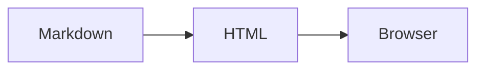

# mdview

A small Markdown-to-HTML compiler written in C. Run it on a Markdown file to
create a styled, temporary HTML page and open it in your default browser.
There are no rendering libraries or language-runtime dependencies.

## Install with Homebrew

```sh
brew install danielhundhausen/tap/mdview
mdview foo.md
```

The formula builds from source. On Linux, `xdg-open` must also be installed
through your system's package manager to open the browser.

## Build from source

```sh
make
./mdview foo.md
```

To use `mdview` from anywhere, install it into a directory on your `PATH`:

```sh
make install PREFIX="$HOME/.local"
# Add $HOME/.local/bin to PATH if it isn't already there.
mdview foo.md
```

The build needs a C99 compiler and Make. macOS uses `open`; Linux uses
`xdg-open`, which must be installed to launch your browser. The renderer itself
needs neither command when using `--no-open`.

## Usage

```sh
mdview notes.md                      # Render and open in your browser
mdview --no-open notes.md            # Render and print the temporary HTML path
mdview -o notes.html notes.md        # Save to a chosen file and open it
mdview --no-open -o notes.html notes.md
cat notes.md | mdview -              # Read standard input
mdview -- --strange-filename.md      # Filenames beginning with a dash
mdview --help
```

The command prints the absolute HTML path. Temporary files have a `.html`
extension, unique names, and owner-only permissions. They go into `TMPDIR`,
or `/tmp` when it is unset. They remain after the command exits so the browser
can read and reload them; delete them when you no longer need them. Explicit
output files are overwritten, except that overwriting the source is rejected.
Rendering is a snapshot: rerun the command after
editing the Markdown.

Relative images and links resolve against the source file's directory, even
when the HTML is in a temporary directory. For standard input, they resolve
against the current working directory. The generated page includes its own
CSS with a warm paper layout, serif headings, system fonts, light/dark themes,
accessible link focus indicators, responsive layout, and print styles. Ordinary
Markdown pages use no JavaScript, web fonts, or remote stylesheets. Mermaid
diagrams load a browser renderer as described below. Remote images can still
be loaded if the document references them.

## Mermaid diagrams

Use a fenced block labeled `mermaid`:

````markdown

````

Diagrams use the document's colors and system font, adapt when the light/dark
theme changes, and scale down to fit the reading column. Use **Expand** to open
a diagram in a full-screen overlay, with zoom controls, **Fit width**, and a
100% view. Close with the button, Escape, or a click on the backdrop. The original
diagram source is available in a disclosure below each diagram.

The executable contains **Mermaid 12.1.0**, compressed with DEFLATE. A small
vendored C decompressor expands the library into the generated HTML only when
Mermaid fences are present. The binary is approximately 1.66 MB; diagram pages
include approximately 5.5 MB of JavaScript. Ordinary pages remain small.

Diagram rendering requires browser JavaScript and works offline. No Node.js,
zlib installation, CDN connection, or accompanying runtime files are needed.
Diagram text stays local. If JavaScript is disabled or diagram syntax is invalid,
the escaped source remains readable. External images, links, or explicitly
configured remote icon resources can still use the network.
Mermaid runs in strict mode, which disables diagram click handlers and encodes
HTML labels. See the [Mermaid usage guide](https://mermaid.js.org/config/usage).

## Markdown support

- ATX (`#`) and single-line Setext headings, paragraphs, and horizontal rules
- Bold, italics, combined emphasis, strikethrough, and punctuation escapes
- Inline code, fenced code with optional language labels, and indented code
- Mermaid diagrams in `mermaid` fences, including inside lists and blockquotes
- Bullet and numbered lists, nested lists, and task checkboxes
- Blockquotes, including nested blocks
- Inline links and images, optional quoted titles, and angle-bracket URL/email links
- Pipe tables with left, center, and right column alignment
- Hard line breaks from two trailing spaces or a trailing backslash
- UTF-8 text, optional UTF-8 BOM, and Unix/Windows line endings

This is a pragmatic Markdown subset, not a full CommonMark or GitHub Flavored
Markdown implementation. Reference-style links, footnotes, automatic heading
IDs, bare URL linking, syntax highlighting, and some complex delimiter/list/
table edge cases are not supported. Raw HTML is displayed as text. URL schemes
are limited to `http`, `https`, `mailto`, and `file`, plus relative paths.
Nesting is bounded to keep malformed documents from exhausting the C stack.

## Tests

```sh
make test
make test-js
```

`make test` requires Python 3 and covers rendering, malformed input, CLI errors,
asset paths, temporary-file permissions, module activation, and browser launching
with a stub command. It also verifies the decompressed library's SHA-256 against
the vendored manifest. `make test-js` requires Node.js and tests the Mermaid
adapter with a mocked renderer, including missing-runtime fallback, syntax
errors, and theme changes. Neither suite opens a browser or downloads Mermaid.

For a real-library integration test without browser control, install `jsdom`
and `svgdom` into a temporary directory and run:

```sh
npm install --prefix /tmp/mdview-dom-test --no-audit --no-fund jsdom@27.0.1 svgdom@0.1.22
node tests/render_offline.mjs ./mdview tests/fixtures/opentelemetry-demo.md /tmp/mdview-result /tmp/mdview-dom-test
```

This executes the generated HTML's actual Mermaid bundle in a DOM emulator,
uses SVG font metrics and geometry from svgdom, blocks network requests, renders
two substantial upstream OpenTelemetry diagrams in light and dark themes, and
writes SVGs, a rendered HTML snapshot, and a JSON report. It verifies the actual
library integration; it does not replace a browser-specific layout test.

### Rendering modules

Fenced-code extensions live outside the Markdown parser. `render_modules.h`
defines the module interface, `render_modules.c` registers modules and tracks
which are used by a document, and `mermaid_module.c` owns Mermaid's markup and
runtime. `mermaid_styles.css`, `mermaid_adapter.js`, and `diagram_viewer.js` own
the diagram styles, rendering adapter, and modal viewer. These assets are
embedded by the C build helper. To add another renderer, implement a `RenderModule`,
register it, and add its C source to `SOURCES` in the Makefile. Module assets are
included once, only in documents that use the corresponding fence language.
The optional `emit_runtime` callback supports compressed runtime assets. The
build-time asset converter is also written in C; normal builds use only Make
and a C99 compiler, with no network access.

For a sanitizer build:

```sh
make clean
make CFLAGS='-g -O1 -std=c99 -Wall -Wextra -Wpedantic -fsanitize=address,undefined -fno-omit-frame-pointer'
make test
```

## License

mdview is MIT licensed; see [LICENSE](LICENSE). Bundled Mermaid and miniz retain
their upstream licenses under `vendor/`. The OpenTelemetry test diagrams are
CC BY 4.0, with source attribution and license under `tests/fixtures/`.
