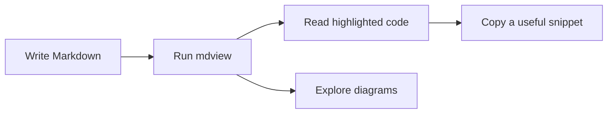

# Markdown, in full color

A repository-only showcase of every Markdown element supported by **mdview**.
Start with the highlighted code below, try its copy icon, then explore
headings, lists, tables, images, and interactive diagrams.

## Syntax highlighting and copying

Language labels select the highlighter. Strings, comments, numbers, and keywords
have distinct colors; copying returns the code itself, including its newlines.

### JavaScript

```javascript
// Keywords, strings, numbers, and a template literal.
const readers = ["Ada", "Linus", "Grace"];

function welcome(name, index) {
  return `${index + 1}. Hello, ${name}! 🌍`;
}

readers.map(welcome).forEach(message => console.log(message));
```

### Python

```python
from dataclasses import dataclass

@dataclass
class Document:
    title: str
    pages: int = 3

    def summary(self) -> str:
        """Keep the source readable, even without JavaScript."""
        return f"{self.title}: {self.pages} pages"

print(Document("Café notes").summary())
```

### C

```c
#include <stdio.h>

int main(void) {
    const char *message = "Hello, Markdown!";
    for (int i = 0; i < 3; ++i) {
        printf("%d: %s\n", i + 1, message);
    }
    return 0;
}
```

### Shell, JSON, and SQL

The `sh` alias and uppercase `SQL` label work too.

```sh
# Render a document without opening a browser.
make
./mdview --no-open -o /tmp/example.html example.md
```

```json
{
  "title": "Technical notes",
  "offline": true,
  "languages": ["javascript", "python", "c"],
  "revision": 42,
  "previous": null
}
```

```SQL
SELECT title, COUNT(*) AS readers
FROM documents
WHERE published = TRUE AND revision >= 2
GROUP BY title
ORDER BY readers DESC;
```

### HTML and CSS

Markup inside a code block is shown as code, including script tags.

```html
<!-- Displayed as code, never inserted as active markup. -->
<section class="note">
  <h2>Read &amp; share</h2>
  <button type="button">Say hello</button>
</section>
<script>console.log("This snippet does not execute");</script>
```

```css
/* A warm reading surface. */
.note {
  color: #343630;
  background: #fffdf9;
  padding: 1.5rem;
  border-radius: 8px;
}
```

### Other code block forms

Tilde fences work with language labels:

~~~diff
- Syntax highlighting was missing.
+ Syntax highlighting and copy buttons are available.
~~~

Unlabeled fences stay plain text and still have a copy button:

```
Literal **asterisks**, <angle brackets>, and & ampersands.
  Indentation and blank lines are preserved.

The final newline is copied too.
```

Unknown language labels also stay plain text:

```custom-language
READ document
SHOW colors
COPY source
```

Four-space indented code is supported:

    first line
      a line indented two more spaces

    another paragraph of literal code

A longer fence can contain shorter fences:

````markdown
```js
const nestedFence = true;
```
````

## Text and inline formatting

A paragraph can continue
on another source line without forcing a hard line break.

Use **bold**, __also bold__, *italics*, _also italics_, ***bold italics***,
___also bold italics___, and ~~strikethrough~~. Formatting can nest:
**bold with *emphasis***, and *emphasis with **bold***.

Inline code such as `a < b && b > 0` preserves punctuation. Double backticks
can contain a literal backtick: `` `name` ``.

Escape punctuation to display it literally: \*stars\*, \_underscores\_,
\[brackets\], \#hash, and \`backticks\`. A word_with_underscores stays a word.
Raw HTML is escaped too: <kbd>Ctrl</kbd> and <strong>literal tags</strong>.

This line ends with two spaces.  
This appears after a hard line break.

This line ends with a backslash.\
This also appears after a hard line break.

Unicode stays intact: café, naïve, Straße, Ελληνικά, 日本語, and 🌍 ✨.

## Heading styles

The page title and section titles demonstrate ATX levels one and two.

### Level three

A subsection heading.

#### Level four ####

Optional closing hashes are supported.

##### Level five

A smaller heading.

###### Level six

The smallest heading.

Setext level one
===============

A single line followed by equals signs becomes a level-one heading.

Setext level two
---------------

A single line followed by dashes becomes a level-two heading.

## Horizontal rules

Three supported rule markers, with text between them:

---

A rule made from dashes.

***

A rule made from asterisks.

___

A rule made from underscores.

## Lists and tasks

- A bullet marked with a dash.
+ A bullet marked with a plus.
* A bullet marked with an asterisk.
  - A nested bullet.
  - Another nested bullet with **bold text**.
    1. A numbered list inside the nested list.
    2. A second numbered item.

Numbered lists can begin at a number other than one:

3. Write a document.
4. Render it.
5. Read it in your browser.

Parentheses work as numbered-list markers too:

1) Compile the viewer.
2) Open the example.

A list item can contain multiple paragraphs and a code block:

- A longer item with its first paragraph.

  Its second paragraph includes `inline code`.

  ```js
  const insideAList = { readable: true, copyable: true };
  ```

- The next item follows the code block.

Task checkboxes reflect their source state:

- [x] Highlight supported code.
- [X] Copy source without formatting.
- [ ] Write the next document.

## Blockquotes

> A blockquote can contain **formatted text** and multiple paragraphs.
>
> This is its second paragraph.
>
> > A nested quote adds another level.
> >
> > - Quotes can also contain lists.
> > - And another item.
>
> ```python
> print("Code inside a quote has colors and a copy icon.")
> ```

## Links and images

Read the [repository README](README.md "Local documentation") or visit
[**Example website**](https://example.com "A link with a title").
Both [HTTP links](http://example.com) and
[email links](mailto:hello@example.com) are supported.
Angle-bracket links work too: <https://example.com> and <hello@example.com>.
This [local file link](file:README.md "A file URL") uses the allowed `file:` scheme.

The illustration below uses a relative path with a space and an optional title.
It loads from the Markdown file's directory even when the HTML lives elsewhere.


[Open the illustration](<examples/reading flow.svg> "A relative file link").

## Tables

Pipe tables support header cells, inline formatting, and three alignments.
An escaped pipe stays inside its cell.

| Left aligned | Center aligned | Right aligned |
| :--- | :---: | ---: |
| **Bold text** | Ready | 42 |
| *Emphasis* | ✓ | 128 |
| `inline code` | [README](README.md) | 1,024 |
| An escaped \| pipe | ~~Old value~~ | 0 |

## Mermaid diagrams

Diagrams render offline. Use the expand icon to explore them, try the zoom controls,
and open **Diagram source** to inspect or copy their original code.



~~~mermaid
sequenceDiagram
    participant Writer
    participant Viewer
    participant Reader
    Writer->>Viewer: Markdown document
    Viewer-->>Reader: Styled HTML with code and diagrams
    Reader->>Viewer: Copy code
    Viewer-->>Reader: Plain source text
~~~

Mermaid also works inside blockquotes:

> ```mermaid
> flowchart LR
>     A[Quoted source] --> B[Rendered diagram]
> ```

And inside lists:

- A small diagram within a list item.

  ```mermaid
  flowchart LR
      A[List item] --> B[Diagram]
  ```

---

The page follows your system's light or dark theme. The reading column adapts
to narrow windows; wide code and tables scroll horizontally. Print styles hide
interactive controls. With JavaScript disabled, all code and diagram source
remains readable.
