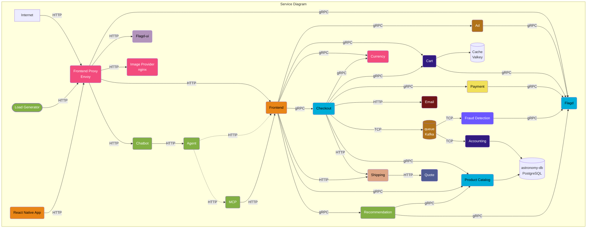
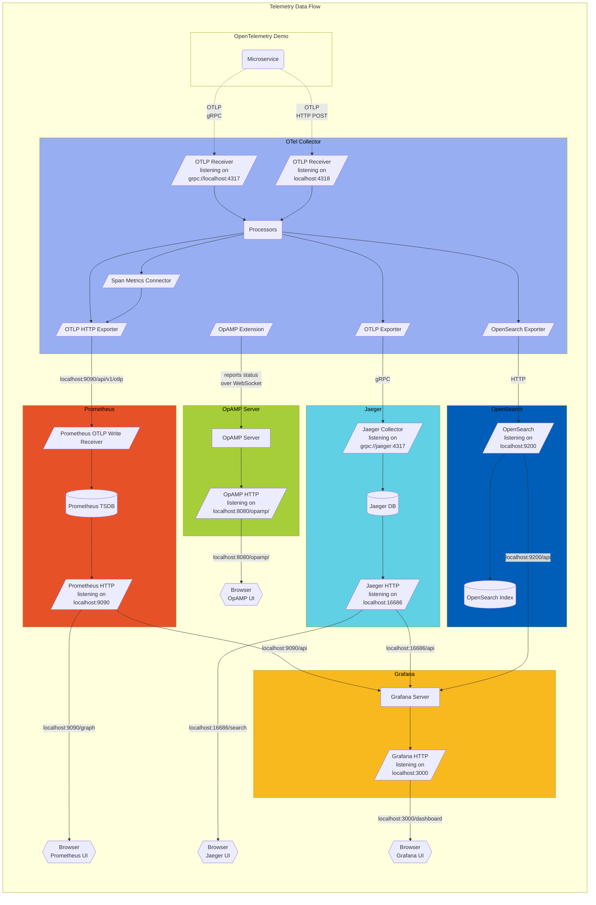

# OpenTelemetry demo architecture

Real-world rendering test using unmodified diagrams from the [OpenTelemetry project](https://github.com/open-telemetry/opentelemetry.io/blob/90f0e2fbac27c38197e716182a811cd120b34ae3/content/en/docs/demo/architecture.md).

## Microservice dependencies

## Telemetry data flow

Diagrams by OpenTelemetry Authors, used under [CC BY 4.0](https://creativecommons.org/licenses/by/4.0/). Source syntax and custom colors are preserved; mdview supplies its own rendering theme.
